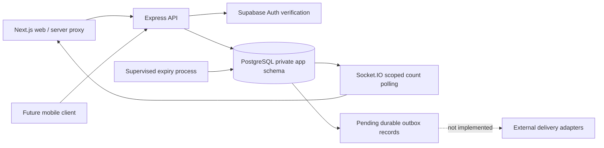

# Backend architecture review — 10 November 2026

## Verdict and scope

The backend is a working development implementation, not a complete production system. The modular-monolith direction is appropriate for the current product; introducing microservices would add operational complexity without resolving the missing workflows. The supplied attachment was zero bytes, so this review uses the checked-out source, migrations, API consumers and executable tests. Existing uncommitted support/content and web work was preserved.

This is a source-level review with synthetic embedded PostgreSQL and local HTTP/Socket.IO tests. It is not a production deployment, a live database audit, a payment certification or an exhaustive concurrency assessment.

## Verified faults corrected

| Fault | Consequence | Correction |
| --- | --- | --- |
| Test script selected only seven files; other tests imported removed APIs | 17 passing tests concealed a failing full typecheck and disconnected features | Discover every top-level test file, reconcile old fixtures/contracts and exercise HTTP/realtime/security tests; limit file concurrency to two |
| Audit writes never called notification recording; notification HTTP routes absent | Live sockets could connect while feeds returned 404 and new changes produced no saved notices | Persist notices in the domain transaction; expose authenticated list/read endpoints |
| Notification access relied on legacy owner/role rules | Active staff missed booking updates; revocation semantics differed from booking permissions | Use active organization memberships and current provider approval for partner access; preserve family ownership and admin scopes |
| Notification API used a separate fixed cursor contract | Violated the project's common pagination contract | SQL-scoped `page`/`pageSize`, default 20/max 100, deterministic sequence/ID order and page metadata; web Previous/Next controls |
| Recipient fan-out loaded staff/admin rows into memory and issued individual inserts | Increasing transaction cost and memory with organization growth | Set-based SQL recipient selection and insertion, with audit/recipient uniqueness |
| Booking API ignored reviewed listing version; edits did not increment it | A parent could submit against changed prices or terms without reviewing them | Require `activityVersion` at HTTP boundary and service command; increment versions on content/publication changes, compare under row locks and snapshot accepted version; update web request |
| Archived children remained eligible for new requests | Archived family records could be reused | Exclude archived children in the owned-child SQL lookup |
| Admin creation could publish for unapproved providers; parent offer acceptance could allocate for suspended providers | Inconsistent approval enforcement across commands | Enforce approval on publication and allocation |
| Realtime readiness was `SELECT 1`; HTTP checked only a few columns | Incomplete schemas could be reported ready | Compare every bundled migration name/checksum with the database ledger |
| Expiry selected/locked the entire overdue queue | Large transactions could delay bookings and recovery | Deterministic SQL batches of at most 100 with `SKIP LOCKED`; transactional capacity release, participant deactivation, outbox, audit and notification writes |
| Expiry lacked shutdown handling and an audit event | In-flight work could be interrupted without a clean drain; history incomplete | Stop scheduling, await current transaction, close pool, bounded shutdown; record `booking.expired` with a null system actor |
| Pool had no idle-error listener or statement limit | Idle connection failures could crash the process; queries could monopolize connections | Sanitized pool error handling and 15-second statement/idle-transaction timeouts |
| Profile email never refreshed after verified identity changes | Application profile could retain stale email | Synchronize the email returned by the authenticated identity service |

No previously applied migration was edited. This release depends on all eight SQL migration files currently bundled with the repository, including files sharing numeric prefixes. Deploy the matching web/API versions together: booking submissions now require the reviewed activity version, and notification pagination uses page parameters.

## Current system and boundaries

The API owns authorization, amounts, booking transitions and database pagination. Clients display server state and submit versioned commands; submission is not confirmation. Booking commands use idempotency records and transactions. Saved notification rows are authoritative; socket signals only request a refresh. API and worker are separate processes using one database, not independent services with duplicated business rules.

Keep this deployment model until measured load demands separation. Gradually split the large platform class into booking, catalogue, organization, family, finance and support modules while retaining one transaction boundary and shared authorization rules. Remove legacy array-returning internal list helpers only after their remaining callers are migrated; they must not become new public API contracts.

## Remaining implementation and release gates

| Priority | Gap | Required completion/evidence |
| --- | --- | --- |
| Release blocker | External outbox delivery has no dispatcher, retry schedule, lease or dead-letter process | Implement claim/lease attempts, bounded backoff with jitter, permanent-failure classification, replay tooling and alerts. Use event/destination idempotency; expect at-least-once delivery. Recheck opt-outs at dispatch. Do not mark sent until the adapter acknowledges |
| Release blocker | Payment collection/receipt verification and refunds are incomplete | Choose collector/verifier permissions and provider; implement signature-verified webhook inbox with unique event IDs, transactional transitions, reconciliation, private receipt storage/scan/access and sandbox evidence |
| Release blocker | Business policy is unfinished | Approve pending-request/offer timeouts, partial cancellations/rescheduling, recurring/package behavior, taxes/fees and subscription renewal/grace/expiry rules before implementing automatic decisions |
| Release blocker | Deployment/recovery is unproven | Separate staging/production credentials; least-privilege runtime versus migration roles; supervised API/worker processes; migration rehearsal, rollback/recovery plan and tested backup restoration with agreed RPO/RTO |
| Release blocker | Operational visibility is insufficient | Structured redacted request/job logs, correlation IDs, latency/error metrics, outbox age, expiry backlog and worker heartbeat alerts; synthetic readiness checks. The API health endpoint does not prove worker liveness |
| Release blocker | Privacy lifecycle and granular access remain unfinished | Approved retention/consent/deletion policy, deletion processor and receipt/contact access rules; invitation and branch/finance capabilities; authorization tests for every role/resource combination |
| High | Concurrency and scale evidence is limited | Real PostgreSQL multi-session tests for booking/cancel/expiry/publication/suspension races and lock ordering; load tests for counts, polling, fan-out and growing lists. PGlite serializes a single connection and cannot establish these guarantees |
| High | Proxy and multi-instance behavior is unverified | Explicit proxy trust/edge rate-limit design; Socket.IO polling affinity; reconnect/revocation behavior under auth/database outages. In-memory rate limits are per process, not a distributed abuse-control system |
| High | Stale catalogue edits can still overwrite each other | Add mandatory expected version to all editing/publication commands and matching management UI. This review protects parent consent against price/terms changes; it does not provide full optimistic editing concurrency |
| High | Product/API drift remains | Reconcile missing account/profile/deletion/history and alternative-session workflows with the web/mobile roadmap and API contract. Existing documentation contains claims from other increments that are not proof of this checkout's completeness |

Notifications are dashboard-only. Pending outbox rows must not be mistaken for delivered email, WhatsApp or push messages. No external transport was enabled, no real child records were used and no payments were processed.

## Verification

Completed locally: all **25 backend tests passed**; backend typecheck/build passed; web typecheck, lint and production build passed. Both repository diff whitespace checks passed. Tests and the Next.js build required permission to spawn processes outside the restricted sandbox. These results include existing uncommitted work in the shared checkouts.

Validation commands: backend `npm run typecheck`, `npm test`, `npm run build`; web `npm run typecheck`, `npm run lint`, `npm run build`. The expanded tests cover migration checksums/private-schema grants, missing-migration readiness, stale listing rejection, booking idempotency, finance gating, suspension, notification rollback/isolation/revocation, Socket.IO authentication and bounded expiry. The automation regression additionally verifies that payment-review bookings retain their capacity and repeated sweeps do not release places twice.

Treat hosted concurrency, worker signal handling under a real process supervisor, browser notification interaction and backup restoration as staging gates, not as outcomes of these local tests.
